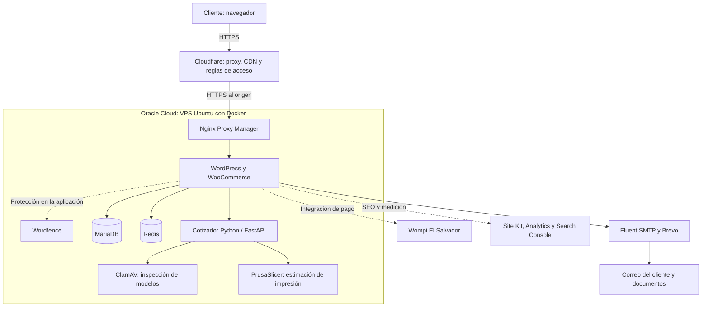
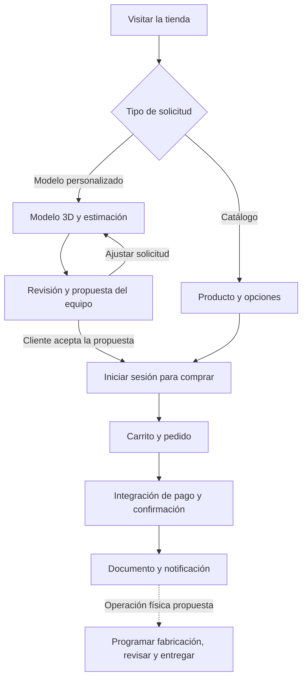
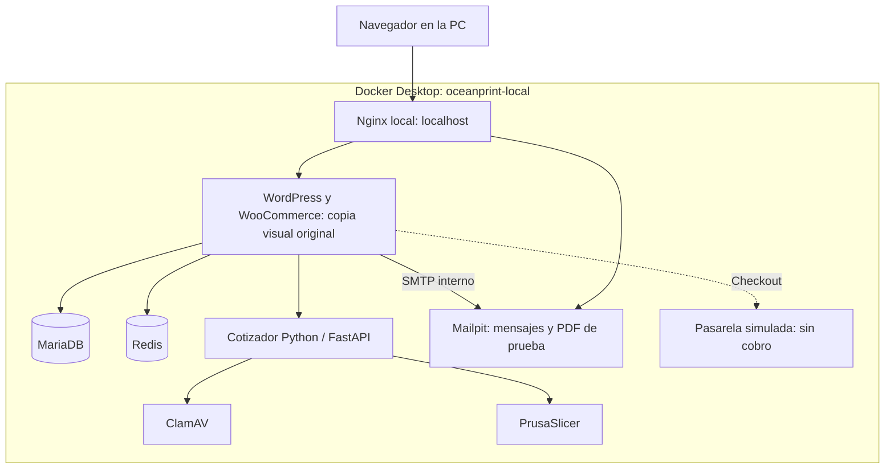

# OceanPrint3D: e-commerce e infraestructura en VPS

**WordPress · WooCommerce · Ubuntu · Docker · Cloudflare · Integración de servicios**

Proyecto académico grupal · UEES · Comercio Electrónico y Formulación y Evaluación de Proyectos

En OceanPrint3D participé en el diseño, la configuración y la integración de una tienda de impresión 3D alojada en una **VPS Ubuntu de Oracle Cloud**. La solución reunía catálogo, pedidos y solicitudes personalizadas, con Cloudflare delante del sitio y servicios de datos, cotización, correo y protección.

Este caso presenta primero **cómo estaba organizado el proyecto en la VPS y qué aprendí al trabajar con él**. La adaptación a Docker en Windows se explica después como una forma de conservarlo y demostrarlo localmente. La antigua instancia ya no está activa.

## De la idea a la tienda

El proyecto evolucionó entre actividades de Comercio Electrónico y trabajos de Formulación y Evaluación de Proyectos. En estos últimos desarrollamos el problema, la propuesta de valor, el análisis del entorno y la planificación de la operación para el contexto salvadoreño.

La necesidad planteada fue **centralizar información del producto, opciones y pedido**, para que la persona comprendiera qué estaba comprando sin depender de conversaciones dispersas. Esa idea orientó el sitio y su administración.

Los trabajos distinguen el prototipo de la futura operación comercial. Aquí explico la solución tecnológica y el aprendizaje; los estudios completos, las proyecciones, los costos y la estrategia comercial se conservan de forma privada.

## Arquitectura original en la VPS

El recorrido web empezaba en el navegador, pasaba por **Cloudflare** y llegaba al proxy de la VPS. **Nginx Proxy Manager** encaminaba la solicitud a WordPress; WooCommerce gestionaba el comercio y el cotizador atendía el procesamiento especializado.

**Wordfence y Fluent SMTP son plugins de WordPress**, no contenedores independientes. El visor **Three.js** se ejecutaba en el navegador. El esquema omite direcciones, claves y detalles de cuentas.

| Área | Componentes originales | Función y aprendizaje |
| --- | --- | --- |
| Acceso del cliente | Dominio, Cloudflare y HTTPS | Relacionar DNS, proxy, certificados y origen |
| Entrada a la VPS | Nginx Proxy Manager | Encaminamiento y separación del acceso público de los servicios internos |
| Tienda y administración | WordPress, WooCommerce y tema visual | Páginas, categorías, productos, cuentas, carrito y pedidos |
| Protección | Wordfence y controles de servidor/Cloudflare | Distinguir capas y responsabilidades |
| Datos y caché | MariaDB y Redis | Persistencia y caché de objetos |
| Personalización | Plugin, FastAPI, Three.js, PrusaSlicer y ClamAV | Archivo, visualización, análisis y estimación con revisión del equipo |
| Comunicación | PDF, Fluent SMTP y Brevo | Relacionar solicitudes y pedidos con documentos y notificaciones |
| Pago | Plugin Wompi El Salvador | Integrar pedido y proveedor, sin atribuir cobros reales a las pruebas |
| Visibilidad | Rank Math, Site Kit, Analytics y Search Console | SEO, medición e indexación |
| Continuidad | Respaldos programados y copias cifradas externas | Comprender qué conservar y qué requiere una recuperación |

[Arquitectura original, protección y respaldos](docs/ARQUITECTURA.md#arquitectura-original-en-vps).

## Recorrido del cliente y operación

La compra de catálogo y la solicitud personalizada comparten el registro del pedido, pero la segunda requiere revisión.

Los documentos de clase relacionan compra digital con fabricación bajo demanda, calidad y entrega. Esa última etapa es el **proceso operativo propuesto**; las capturas no prueban entregas comerciales. La estimación tampoco sustituye la aprobación del equipo.

[Ver el cotizador con un modelo cargado y la estimación](docs/RECORRIDO_VISUAL.md#11-cotizador-3d).

## Mi participación y lo que aprendí

La idea inicial surgió de un compañero y la realización fue grupal. Mi aporte se concentró en **definir el diseño y el comportamiento de la web, configurar WordPress y participar en la integración y el trabajo guiado con la VPS**. Mis compañeros aportaron contenido, precios, conocimiento de la impresora y pruebas.

Los trabajos de Formulación y Evaluación de Proyectos también me asignan desarrollo y mantenimiento web. Distingo ese rol planificado de las tareas realizadas y explicadas aquí.

- **Construcción y administración:** páginas, categorías, fichas y recorrido entre carrito, pedido y administración.
- **Infraestructura e integración:** Ubuntu, Docker Compose, redes, volúmenes y conexiones entre aplicación, datos y cotizador.
- **Acceso y protección:** recorrido Cloudflare–proxy–WordPress y controles del servidor, aplicación y archivos.
- **Correo y documentos:** Fluent SMTP/Brevo y relación entre estados, mensajes y PDF.
- **SEO y medición:** Rank Math, Site Kit y Search Console, sus conexiones y los tiempos de recopilación e indexación.
- **Continuidad:** relación entre configuración, respaldos y recuperación.
- **Criterio de negocio:** traducir una propuesta a funciones y distinguir solicitud, estimación, aprobación y pedido.

Utilizamos **IA de forma importante en implementación y configuraciones**. Mi participación incluyó plantear necesidades, dirigir el diseño, revisar resultados y solicitar ajustes; no presento el trabajo como programación manual individual. Algunas configuraciones avanzadas requieren seguir reforzando mi comprensión.

[Contexto y participación](docs/CONTEXTO_Y_PARTICIPACION.md) · [Resultados y aprendizajes](docs/RESULTADOS_Y_APRENDIZAJES.md)

## Adaptación local para conservar y demostrar el proyecto

El laboratorio conserva la presentación original, sus páginas, imágenes y catálogo académico, junto con la tienda y el cotizador. Usa cuentas y operaciones ficticias, claves locales nuevas y servicios de prueba. No reproduce Cloudflare ni vincula cuentas de producción.

| Cambio respecto a la VPS | Finalidad local |
| --- | --- |
| Dominio/Cloudflare/HTTPS → localhost | Ejecutar la demostración desde una PC |
| Wompi → pasarela simulada | Recorrer pedidos sin tarjeta ni cobro |
| Fluent SMTP/Brevo → Mailpit | Revisar mensajes y adjuntos sin enviarlos a Internet |
| Usuarios y pedidos históricos → cuentas y operaciones ficticias | Instalación reutilizable sin compartir datos privados |
| Configuración VPS → secretos locales nuevos | Separar accesos por entorno |

El grupo final es **`oceanprint-local`**: tienda en el puerto **8084** y correo en **8085**. [Detalle de la adaptación](docs/ARQUITECTURA.md#adaptación-local).

## Recorrido visual

La galería reúne **14 capturas renovadas el 26/11/2026** de la demo final que corresponde a la implementación privada verificada. Incluye inicio y categorías, catálogo, contenido, cuenta, carrito, checkout, cotizador, seguimiento del cliente, administración, pedido y correo.

[Ver las 14 capturas explicadas](docs/RECORRIDO_VISUAL.md).

## Qué quedó funcionando en la demostración

| Recorrido | Resultado de la prueba local |
| --- | --- |
| Catálogo y carrito | Búsqueda, opciones del producto, variantes y actualización de cantidades |
| Compra | Pedidos con envío y recogida en Procesando, sin cobro real |
| Solicitud personalizada | STL, visor, estimación, envío al equipo y seguimiento desde la cuenta |
| Revisión | Aprobación desde administración y notificación al cliente |
| Comunicación | Consulta de contacto, correos de pedido y factura PDF en Mailpit |
| Conservación | Instalación limpia con contenido visual seleccionado y cuentas ficticias, sin importar accesos o pedidos históricos |

La estimación de ejemplo fue de **$3.60 para 15 copias** de un cubo sintético. Es una comprobación del flujo técnico, no un resultado comercial ni una tarifa vigente. [Validación y alcance](docs/EVIDENCIA_Y_ESTADO.md).

> **Caso académico y documental.** Este repositorio no opera una tienda pública ni contiene código, bases, accesos o documentos comerciales completos. Los esquemas de la VPS describen el entorno histórico; las pruebas locales no acreditan cobros reales. [Aviso académico](AVISO_ACADEMICO.md).
