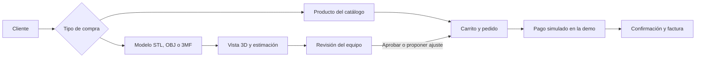
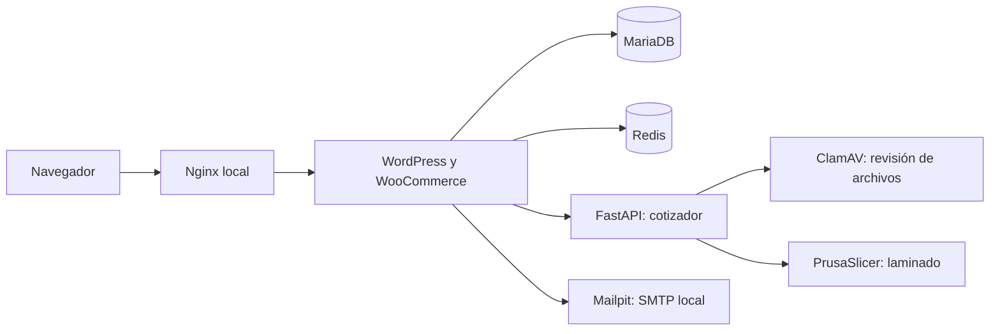

# OceanPrint3D: comercio electrónico y cotización de impresión 3D

**Caso de estudio académico · UEES · Comercio Electrónico · 2026**

Participé en el desarrollo de una tienda de impresión 3D que combina un catálogo de productos con solicitudes de piezas personalizadas. El cliente puede explorar productos o subir un modelo, obtener una estimación preliminar y enviarla al equipo para revisión antes de continuar con la compra.

Aquí presento el problema, el recorrido de la solución, mi participación y las pruebas realizadas. La implementación se conserva en un repositorio privado. Las evidencias corresponden a demostraciones locales; los pagos son simulados y los correos de prueba permanecen en un buzón interno.

## El problema que buscábamos resolver

En la propuesta de valor del curso planteamos una dificultad: encontrar productos personalizados y entender qué se puede fabricar, con qué material y a qué precio. Una solicitud por mensajes puede dejar incompletos el archivo, las medidas, la cantidad o el detalle de lo que el cliente necesita.

Nuestro objetivo fue reunir catálogo, cotización y seguimiento en un mismo sitio. Para las piezas personalizadas, elegimos separar la **estimación automática** de la **aprobación del equipo**: un cálculo de material y tiempo no basta para garantizar que una pieza pueda fabricarse con el acabado esperado.

## Cómo funciona la solución

| Parte del proyecto | Qué permite hacer |
| --- | --- |
| Tienda | Consultar productos, categorías y precios; utilizar cuenta, carrito y pedidos |
| Cotizador | Subir un modelo y ajustar material, color, escala, relleno, capa y cantidad |
| Revisión | Consultar solicitudes y aprobar, rechazar o proponer un precio revisado |
| Documentos y correo | Generar cotización/factura PDF y revisar notificaciones en el buzón local |
| Infraestructura | Conectar la web, base de datos, caché, cotizador y antivirus mediante contenedores |

## Qué pude comprobar

La recuperación local permitió verificar el recorrido de la aplicación y preparar una segunda distribución con instalación nueva y datos ficticios.

| Prueba | Resultado observado |
| --- | --- |
| Instalación limpia | WordPress, dependencias y datos de ejemplo creados sin importar la base histórica |
| Catálogo de demostración | Seis productos ficticios y cuatro categorías |
| Cálculo de un cubo de 20 × 20 × 20 mm | Análisis de geometría y laminado con perfil A1 Mini adaptado a PrusaSlicer |
| Cotización de 15 copias | Estimación de **$3.60** con la configuración de prueba |
| Pedido de prueba | Estado **Procesando** mediante la pasarela simulada |
| Documentos y notificaciones | PDF de cotización y factura; correos recibidos en Mailpit con adjuntos |

Son resultados de pruebas funcionales. El importe no es una tarifa comercial recomendada, y no presento metas de mercadeo o proyecciones financieras como ventas obtenidas. [Ver pruebas y alcance](docs/RESULTADOS_Y_APRENDIZAJES.md).

## Tecnología y arquitectura

**WordPress · WooCommerce · Python/FastAPI · Three.js · PrusaSlicer · MariaDB · Redis · ClamAV · Docker Compose · Ubuntu · Mailpit**

El proyecto original funcionaba en una VPS Ubuntu de Oracle Cloud, con dominio y servicios externos. Para conservarlo y demostrarlo en una PC, preparamos una adaptación con contenedores, claves locales nuevas, pagos simulados y correo interno. La integración original de Wompi se describe como parte del proyecto; las pruebas actuales no acreditan un cobro real.

[Comparación entre VPS y local](docs/ARQUITECTURA.md) · [Recorrido visual](docs/RECORRIDO_VISUAL.md)

## Mi participación y lo que aprendí

La idea inicial surgió de un compañero y el proyecto se desarrolló en grupo. Mi participación se concentró en el diseño de la web, la configuración de WordPress y el trabajo guiado con la VPS. Mis compañeros aportaron productos, precios, conocimiento de la impresora y pruebas del cotizador.

Utilizamos IA de forma importante para implementar código, resolver problemas y apoyar parte de la configuración. También hubo asistencia en la recuperación y adaptación local. Mi aporte incluyó definir el comportamiento y la presentación, revisar el resultado y participar en la integración; no atribuyo todo el desarrollo a programación manual individual.

El proyecto me permitió practicar cómo se relacionan una aplicación web, sus datos y los servicios que la sostienen. Es la parte que más me interesa seguir desarrollando: **infraestructura, operación de sistemas y soluciones que respondan a una necesidad de negocio**. [Contexto y participación](docs/CONTEXTO_Y_PARTICIPACION.md).

## Cómo recorrer este caso

1. Revisa el [recorrido visual](docs/RECORRIDO_VISUAL.md): tienda, cotizador, pedido y correos.
2. Consulta la [arquitectura](docs/ARQUITECTURA.md) para entender la integración y la adaptación local.
3. Lee los [resultados y aprendizajes](docs/RESULTADOS_Y_APRENDIZAJES.md) para distinguir pruebas, decisiones y mejoras posibles.

Este repositorio documenta un proyecto académico y no ofrece una tienda comercial activa. No contiene código de la aplicación, bases de datos, credenciales ni datos personales del equipo o de clientes. [Aviso académico y uso de evidencias](AVISO_ACADEMICO.md).
