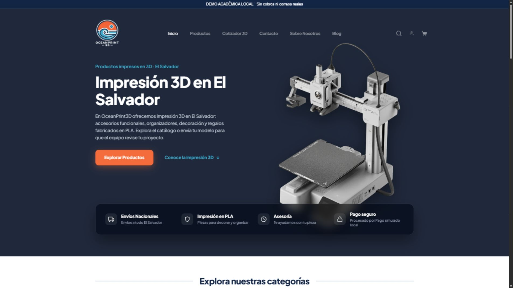
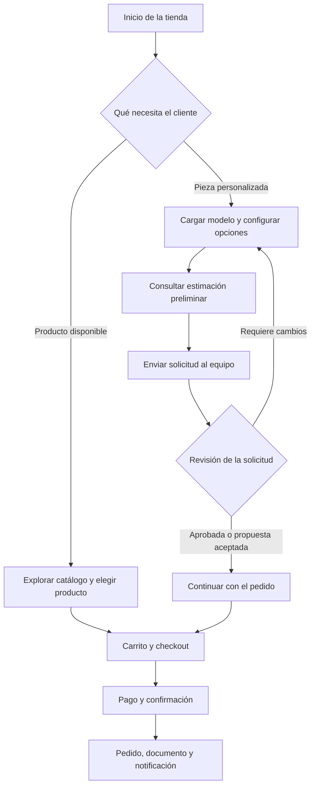
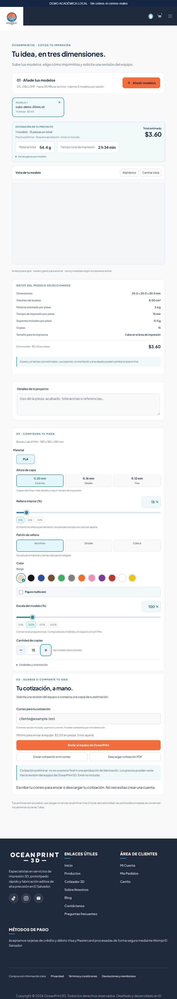
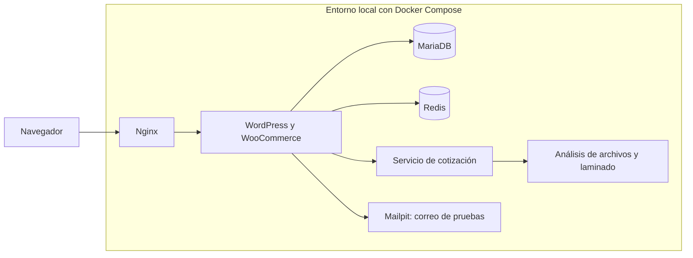

# OceanPrint3D: caso de e-commerce con WordPress

**WordPress · WooCommerce · Docker · Ubuntu · Integración de servicios**

Proyecto académico grupal · Comercio Electrónico · UEES · 2026

En este proyecto participé en la construcción de una tienda de impresión 3D: presentación del negocio, catálogo, pedidos y solicitudes de piezas personalizadas mediante un cotizador. Mi interés fue aprender cómo llevar una propuesta de clase a una solución web y cómo conectar los servicios necesarios para operarla.

El trabajo partió de una propuesta de valor y un plan de mercadeo elaborados en clase para el contexto de El Salvador. Aquí me concentro en la solución tecnológica y en lo que aprendí; la planificación comercial y la implementación se conservan de forma privada.

## Del planteamiento a la solución

Buscábamos que una persona pudiera conocer la oferta, consultar productos y solicitar una pieza personalizada desde un mismo sitio. Para esa segunda opción, necesitábamos reunir el modelo, sus características y la cantidad solicitada, y dar al equipo la oportunidad de revisar la petición antes de continuar con el pedido.

Elegimos **WordPress y WooCommerce** como base para la tienda y conectamos un servicio especializado para la cotización. Esto permitió trabajar tanto la experiencia del cliente como la administración del catálogo, los pedidos, los documentos y las notificaciones.

### Recorrido de compra

El cliente tiene dos entradas. La compra de catálogo avanza al carrito; una pieza personalizada pasa primero por estimación y revisión.

En la demostración local, el pago se simula y las notificaciones se reciben en un buzón interno.

## Qué integra el proyecto

| Área | Función dentro de la tienda | Aprendizaje aplicado |
| --- | --- | --- |
| Presentación y catálogo | Inicio, categorías, fichas y navegación | Organizar contenido, diseño y recorrido del cliente con WordPress |
| Comercio electrónico | Carrito, checkout, cuentas y estados de pedidos | Configurar WooCommerce y relacionar la compra con su administración |
| Cotización personalizada | Archivo 3D, visor y opciones de impresión | Integrar la web con un servicio de cálculo y presentar una estimación |
| Revisión administrativa | Solicitudes y propuestas antes de comprar | Distinguir una estimación automática de una decisión del equipo |
| Documentos y correo | Cotizaciones, facturas y notificaciones | Conectar los eventos del negocio con PDF y transporte SMTP |
| Operación del sitio | Base de datos, caché y servicios en contenedores | Entender dependencias, persistencia y configuración por entorno |
| Visibilidad y mantenimiento | SEO, medición y herramientas de protección | Reconocer que publicar una web también requiere seguimiento y mantenimiento |

## Tecnologías y decisiones

### Aplicación e integración

- **WordPress y WooCommerce:** base del sitio, catálogo y gestión de pedidos.
- **Python/FastAPI, Three.js y PrusaSlicer:** servicio de cotización, visualización del modelo y estimación de impresión, con asistencia de IA en su implementación.
- **MariaDB y Redis:** almacenamiento de la aplicación y caché de objetos.
- **ClamAV:** inspección de archivos recibidos por el cotizador.
- **Docker Compose y Ubuntu:** organización de los servicios y práctica de operación en VPS.

### Herramientas del sitio original

Trabajamos con **Fluent SMTP y Brevo** para configurar el correo, **Wordfence** para protección del sitio, **Rank Math SEO** para sus ajustes de posicionamiento y **Google Site Kit / Search Console** para conocer el proceso de medición e indexación. También integramos el plugin de **Wompi El Salvador** como parte del proyecto original.

Estas herramientas me ayudaron a ver el e-commerce como un conjunto de servicios. Instalar un plugin es solo un paso: también hay que entender su configuración, sus conexiones y su mantenimiento. Las métricas dependen de la recopilación y actualización de cada servicio; no las presento como información instantánea ni como resultados comerciales obtenidos.

### VPS y trabajo local

La versión original se alojaba en una **VPS Ubuntu de Oracle Cloud**, con dominio y servicios externos. La versión local conserva la integración en Docker, utiliza datos ficticios y sustituye el cobro y la entrega externa de correo por servicios de demostración.

[Arquitectura original y local](docs/ARQUITECTURA.md) · [Recorrido visual completo](docs/RECORRIDO_VISUAL.md)

## Mi participación y aprendizajes

La idea inicial surgió de un compañero y el trabajo fue grupal. Mi aporte se concentró en **definir el diseño y el comportamiento de la web, configurar WordPress y participar en la integración y el trabajo con la VPS**. Mis compañeros aportaron productos, precios, conocimiento de la impresora y pruebas del cotizador.

Lo que más rescato de este proyecto es haber practicado:

- **Construcción y administración de una tienda:** organizar páginas, categorías, productos y el recorrido de compra; relacionarlos con pedidos y documentos.
- **Integración de servicios:** entender cómo WordPress se comunica con el cotizador, la base de datos y el correo, y por qué una web necesita más que una interfaz.
- **Infraestructura:** trabajar con una VPS Ubuntu, Docker Compose, configuración, volúmenes y dependencias entre servicios.
- **Correo, SEO y medición:** conocer la configuración SMTP, los ajustes SEO y la relación del sitio con Site Kit y Search Console.
- **Recuperación y adaptación:** separar datos, accesos y servicios externos para conservar una demostración que pueda ejecutarse en una PC.
- **Criterio de negocio:** distinguir catálogo, solicitud, estimación, aprobación y pedido, en lugar de tratarlos como una sola operación.

Utilizamos IA de forma importante para implementar código, resolver problemas y apoyar configuraciones. La recuperación local también fue asistida. Presento mi participación en el diseño, la configuración y la revisión del trabajo; el detalle de responsabilidades está en [contexto y participación](docs/CONTEXTO_Y_PARTICIPACION.md).

Este caso refleja mi interés por **infraestructura, operación de sistemas e integración de soluciones para un negocio**. [Resultados y aprendizajes](docs/RESULTADOS_Y_APRENDIZAJES.md) desarrolla estas ideas y las posibles mejoras.

## Recorrido visual

La galería reúne **inicio, catálogo, cotizador, pedido y notificaciones**. Permite seguir la solución desde la tienda hasta su operación sin necesitar acceso a las cuentas ni al código.

[Ver las cinco capturas y su explicación](docs/RECORRIDO_VISUAL.md).

> **Proyecto académico.** Las capturas corresponden a demostraciones locales, con operaciones de prueba. La antigua VPS no se presenta como un servicio activo. Este repositorio contiene documentación e imágenes seleccionadas; el código, los documentos comerciales, los datos y los accesos se conservan aparte. [Aviso académico](AVISO_ACADEMICO.md).
