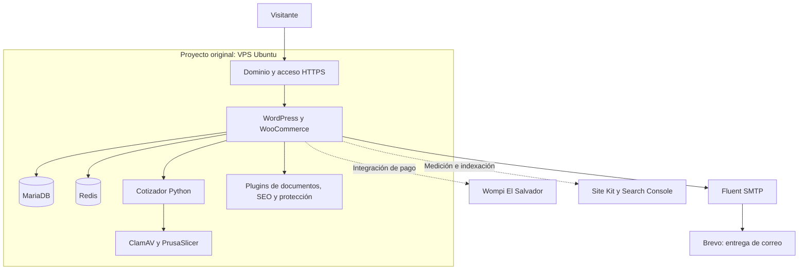
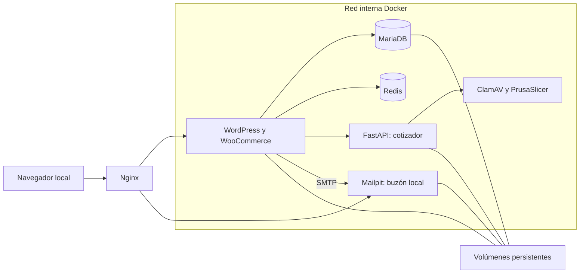

# Arquitectura e integración de servicios

## Cómo organicé la solución

El centro de la aplicación es WordPress con WooCommerce. Allí se presentan los productos y se gestionan las cuentas, el carrito y los pedidos. Para las piezas personalizadas, un plugin conecta la tienda con el servicio Python de cotización. Separar ambas responsabilidades permite entender qué parte gestiona la compra y cuál procesa el modelo.

| Capa | Tecnologías | Papel y aprendizaje |
| --- | --- | --- |
| Sitio y comercio | WordPress, WooCommerce y tema visual | Páginas, catálogo, cuentas, checkout y administración |
| Integración del cotizador | Plugin WordPress, Python/FastAPI | Envío de archivos y configuración; retorno de una estimación |
| Visualización y cálculo | Three.js, PrusaSlicer | Vista 3D y estimación preliminar de material y tiempo |
| Datos y caché | MariaDB, Redis | Persistencia del sitio y caché de objetos |
| Archivos | ClamAV | Inspección previa al procesamiento de modelos |
| Documentos y eventos | PDF, SMTP | Relación entre solicitud, pedido y comunicación con el cliente |
| Operación | Ubuntu, Docker Compose y proxy web | Conexión de servicios, configuración y conservación de datos |

## Entorno original en VPS

El proyecto se alojaba en Ubuntu, en Oracle Cloud. El acceso se hacía mediante dominio y HTTPS, con servicios de la aplicación en contenedores. Además de la tienda y el cotizador, el sitio se relacionaba con correo, pago, SEO y medición.

### Qué aportaban los plugins

- **Fluent SMTP y Brevo:** configuración del envío de notificaciones; el trabajo incluyó correo hacia buzones Hotmail, según la experiencia del proyecto.
- **Wordfence:** acercamiento a herramientas de protección y seguimiento del sitio WordPress. No sustituye la administración de la VPS ni garantiza por sí solo la seguridad de la aplicación.
- **Rank Math SEO:** práctica de ajustes SEO y preparación del contenido para buscadores.
- **Google Site Kit y Search Console:** aprendizaje de la vinculación del sitio con herramientas de medición y del proceso de indexación. Publicar o solicitar indexación no garantiza una posición en búsquedas; los datos tienen sus propios tiempos de actualización.
- **Wompi:** integración del proveedor de pago en el contexto original. Las evidencias actuales utilizan simulación local, sin cobros reales.

Los plugins están presentes en los archivos recuperados; la configuración de Brevo y el uso de herramientas de Google se incorporan también a partir de lo explicado por el autor. Las cuentas, claves y configuraciones comerciales no se publican. El diagrama describe la referencia del proyecto, no un despliegue actualmente activo.

## Entorno local definitivo

La distribución de laboratorio ejecuta la solución en Docker Desktop con contenedores Linux. Su grupo se llama **`oceanprint-local`**. La tienda se consulta en el puerto **8084** y el buzón de pruebas en **8085**, únicamente desde la PC.

| Aspecto | VPS del proyecto | Adaptación local |
| --- | --- | --- |
| Acceso | Dominio y HTTPS | Navegador en localhost |
| Datos | Contenido y configuración del proyecto | Catálogo y cuentas ficticias en instalación nueva |
| Pago | Integración Wompi | Pasarela de prueba sin tarjeta ni cobro |
| Correo | Fluent SMTP con Brevo | Mailpit interno para revisar mensajes y adjuntos |
| SEO y medición | Plugins y servicios vinculados al dominio | Contexto de aprendizaje; no se conectan cuentas externas de producción |
| Configuración | Accesos propios de la VPS | Secretos generados para cada instalación |
| Persistencia | Datos de servicios en el servidor | Volúmenes de Docker conservados al recrear contenedores |

## Decisiones que aprendí a relacionar

**Usar una base existente para el comercio.** WooCommerce permite concentrar el trabajo en la configuración de la tienda y en la integración especializada, en lugar de programar cada parte comercial.

**Mantener revisión humana.** El cálculo ayuda a orientar una solicitud; el equipo revisa si la pieza puede fabricarse y qué condiciones deben confirmarse.

**Separar servicios y conexiones.** Tienda, base, caché, cotizador y correo tienen responsabilidades distintas. Esta separación facilita identificar qué revisar cuando falla una parte del recorrido.

**Conservar datos fuera de los contenedores.** Recrear un servicio y borrar sus datos son acciones diferentes. La adaptación permitió practicar esa distinción y mantener una demostración reutilizable.

**Adaptar las dependencias al entorno.** El correo y el pago locales permiten recorrer la aplicación sin utilizar las cuentas comerciales. Un despliegue futuro necesitaría su propia configuración de dominio, accesos y servicios.
