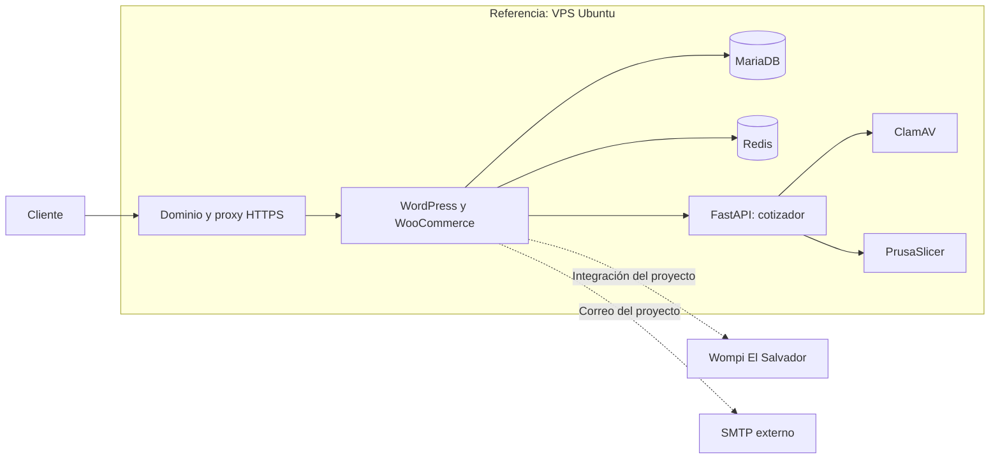
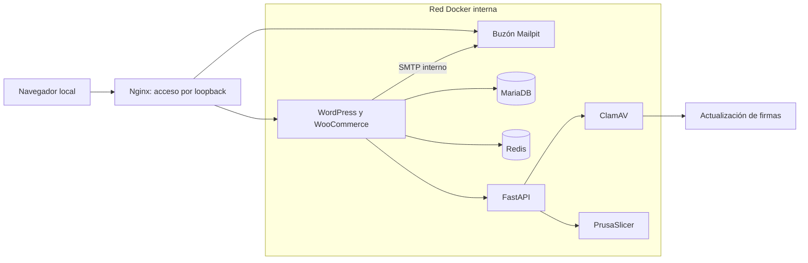

# Arquitectura: del entorno original a la demostración local

## Referencia del proyecto en VPS

El entorno recuperado utilizaba WordPress/PHP Apache, WooCommerce, MariaDB, Redis, cotizador Python y antivirus en una VPS Ubuntu. El acceso web pasaba por un proxy con dominio/HTTPS. La tienda tenía integración de correo externo y del plugin Wompi El Salvador.

Es un esquema de la arquitectura recuperada, no una afirmación de que la VPS, el dominio o los proveedores externos estén operativos hoy. Las pruebas locales no verificaron transacciones reales ni entrega de correo externo.

## Adaptación para una PC

| Componente | Papel en la solución |
| --- | --- |
| WordPress y WooCommerce | Interfaz, cuentas, catálogo, pedidos y estados comerciales |
| Plugin de cotización | Conexión entre la web, el cliente y el servicio de análisis |
| FastAPI | Gestión de archivos, geometría, cálculos y solicitudes |
| Three.js | Vista interactiva del modelo en el navegador |
| PrusaSlicer | Estimación por laminado con un perfil A1 Mini adaptado |
| MariaDB / Redis | Persistencia de WordPress y caché de objetos |
| ClamAV | Inspección de los archivos antes de procesarlos |
| Mailpit | Recepción local de correos y adjuntos para probar notificaciones |
| Docker Compose | Conexión y operación conjunta de los servicios |

## Qué cambió y por qué

- **Datos:** la copia recuperada conserva contenido académico; la distribución privada reproducible genera un catálogo ficticio y una base nueva.
- **Credenciales:** cada instalación genera claves locales. Los respaldos y accesos históricos no forman parte de la distribución compartida.
- **Pagos:** la demo utiliza una pasarela simulada y no solicita tarjetas. El plugin Wompi histórico se mantuvo fuera de la copia redistribuible por las restricciones de su archivo de licencia.
- **Correo:** los mensajes se reciben por SMTP en Mailpit. Es posible comprobar cuerpo, destinatario y PDF sin enviarlos a Internet.
- **Acceso:** los puertos web se publican solo en la interfaz local. Base, caché, API y SMTP permanecen sin puertos públicos.
- **Archivos:** WordPress vive en un volumen Linux de Docker para evitar la lentitud de acceder a miles de archivos mediante un montaje desde Windows.

La distribución nueva utiliza WordPress 7.1.5; los archivos históricos recuperados contenían 7.1.3. Esta adaptación no es un traslado literal de toda la VPS ni una configuración lista para exponer a Internet.

## Decisiones que considero relevantes

**Mantener la revisión humana.** El laminado aporta una estimación; el equipo debe revisar geometría, soportes, acabado y viabilidad antes de fabricar.

**Separar cálculo y comercio.** WordPress gestiona el pedido; el servicio Python analiza el modelo. Así puedo explicar y comprobar cada parte de forma independiente.

**Probar integraciones sin servicios reales.** La simulación de pago y el buzón SMTP permiten recorrer los estados y revisar documentos durante la demostración.

**Conservar datos fuera de los contenedores.** Los volúmenes permiten mantener archivos, base y mensajes cuando se recrean servicios. Su eliminación sigue siendo una operación distinta y debe planificarse.
