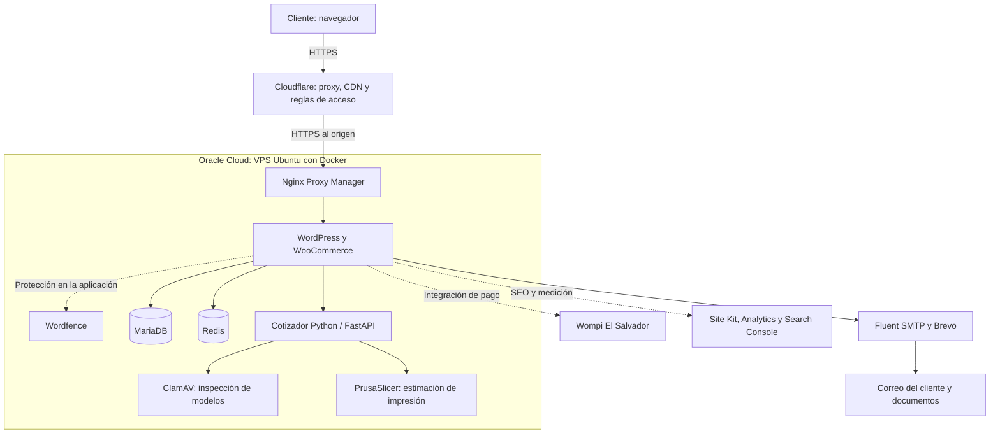
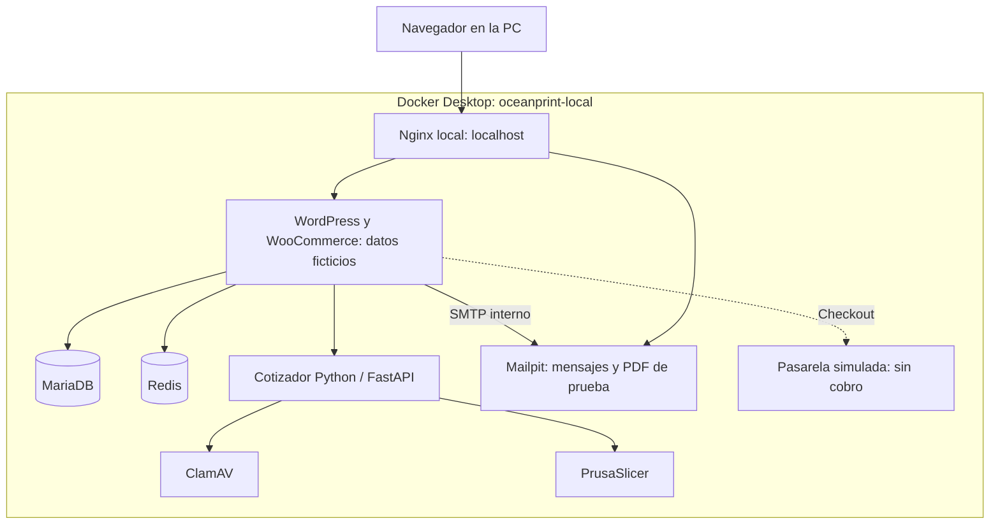

# Arquitectura original y adaptación local

## Arquitectura original en VPS

La referencia principal es el despliegue de OceanPrint3D en una **VPS Ubuntu de Oracle Cloud**, con servicios Docker y acceso mediante dominio. El esquema se reconstruye con documentación técnica y configuración recuperada; describe el entorno histórico, no un servidor actualmente activo.

### Del cliente a la aplicación

1. El cliente accedía al dominio por HTTPS. **Cloudflare** actuaba como proxy/CDN y aplicaba reglas de acceso.
2. La conexión continuaba hacia el origen con TLS. La documentación registra **Full (strict)** y un certificado de origen.
3. **Nginx Proxy Manager**, en la VPS, terminaba la conexión y encaminaba peticiones a WordPress. Era un proxy compartido con otras aplicaciones; el diagrama muestra solo OceanPrint3D.
4. WordPress renderizaba el sitio y WooCommerce gestionaba catálogo, cuentas, carrito y pedidos.

El navegador no accedía directamente a MariaDB, Redis o al backend de modelos. El visor Three.js se ejecutaba en el cliente; el procesamiento del modelo se delegaba al servicio Python.

### Aplicación y servicios internos

| Componente | Responsabilidad |
| --- | --- |
| WordPress/PHP y WooCommerce | Presentación, contenido, cuentas y operación comercial |
| Tema y plugins del proyecto | Diseño e integración de cotizaciones, acciones, documentos y comunicaciones |
| MariaDB | Persistencia de contenido y datos de la tienda |
| Redis Object Cache | Caché de objetos de WordPress |
| Python/FastAPI | Recepción del modelo y coordinación del análisis y estimación |
| Three.js | Visualización interactiva en el navegador |
| PrusaSlicer | Estimación de impresión con un perfil adaptado |
| ClamAV | Inspección de archivos de modelos |
| Docker Compose | Servicios, dependencias, redes, almacenamiento y límites de recursos |

La tienda tenía redes para datos, acceso web y comunicación privada con el cotizador. MariaDB y Redis estaban en la red interna; el backend de modelos se relacionaba con WordPress mediante una red privada. Se omiten direcciones y secretos de conexión.

### Protección por capas

| Capa | Configuración documentada | Aprendizaje |
| --- | --- | --- |
| Borde | Cloudflare, reglas y limitación de solicitudes | Revisar peticiones antes de llegar al origen |
| Conexión al origen | TLS Full (strict), certificado y restricción del acceso directo | Distinguir HTTPS del navegador y conexión al servidor |
| Ubuntu | SSH por claves, firewall y Fail2ban | Separar administración, acceso web y publicaciones Docker |
| WordPress | Wordfence: firewall, análisis y configuración de 2FA para administración | Complementar los controles del borde y del servidor |
| Modelos 3D | ClamAV y validaciones del cotizador | Tratar los archivos antes de procesarlos |

**Wordfence era un plugin dentro de WordPress**, no una puerta independiente delante de toda la VPS. Cloudflare no sustituía los controles del origen. La configuración de 2FA no permite asumir que todas las personas hubieran completado su vinculación.

La caché tenía responsabilidades distintas: Cloudflare para recursos elegibles, caché de páginas para contenido público y Redis para objetos. Cuenta, carrito, checkout y acciones privadas necesitaban tratamiento específico para no reutilizar contenido personal entre visitantes.

Estos componentes describen el diseño documentado; no certifican seguridad ni ausencia de problemas en las dependencias. Las configuraciones avanzadas se trabajaron con asistencia de IA.

### Correo, pago y visibilidad

- **Correo:** Fluent SMTP conectaba eventos de WordPress/WooCommerce con **Brevo**. Cotizaciones y pedidos generaban notificaciones y documentos; el autor recuerda trabajo con destinatarios Hotmail. Las cuentas y los registros se mantienen privados.
- **Pago:** el proyecto integraba el plugin **Wompi El Salvador**. La planificación incluía comprobar pago y pedido antes de operar comercialmente. La existencia del plugin y las pruebas locales no acreditan cobros reales.
- **SEO:** **Rank Math** apoyaba ajustes de contenido y metadatos.
- **Medición e indexación:** **Site Kit**, Analytics y Search Console vinculaban el sitio con herramientas de seguimiento. La documentación conserva comprobaciones históricas. Se omiten identificadores de cuentas y medición. Indexar y medir visitas son procesos diferentes; no garantizan posicionamiento ni datos instantáneos.

### Respaldos y continuidad

La documentación registra respaldos programados con **systemd**, copias locales y transferencia externa con **rclone crypt a Google Drive**, cifrando contenido y nombres. Incluían datos y archivos WordPress, fuentes/configuración de servicios y datos del cotizador.

El proceso conservaba controles de integridad y antecedentes de restauraciones aisladas. Eso no equivale a haber ensayado reconstruir toda la VPS desde cero. Se mantienen privados los accesos, las claves de cifrado y la configuración operativa detallada.

La recuperación posterior me ayudó a entender por qué el respaldo contempla aplicación, datos y configuración, y por qué conservar las claves de recuperación es una responsabilidad diferente de generar la copia.

## Adaptación local

El laboratorio permite conservar y demostrar la aplicación en una PC sin utilizar cuentas comerciales.

El grupo final es **`oceanprint-local`**: tienda **localhost:8084** y correo **localhost:8085**. Solo se publica el acceso local del proxy; base, caché, cotizador y SMTP permanecen dentro de Docker.

| Aspecto | VPS original | Laboratorio local |
| --- | --- | --- |
| Entrada | Dominio, Cloudflare y HTTPS | Nginx por localhost |
| Protección | Borde, servidor y Wordfence | Aislamiento local, controles seleccionados de la aplicación y ClamAV |
| Datos | Contenido académico y configuración del sitio | Catálogo y cuentas ficticias de una instalación nueva |
| Correo | Fluent SMTP/Brevo | Mailpit sin entrega a Internet |
| Pago | Integración Wompi | Pasarela simulada |
| SEO y Google | Plugins y cuentas vinculados al dominio | Contexto de aprendizaje, sin cuentas de producción |
| Persistencia | Datos y archivos en la VPS | Volúmenes Docker |
| Accesos | Configuración propia del servidor | Secretos locales nuevos |

Las capturas conservan parte de la interfaz original. La adaptación no replica toda la protección perimetral ni la operación comercial. Los detalles de instalación, versiones y almacenamiento se documentan con la implementación privada.
