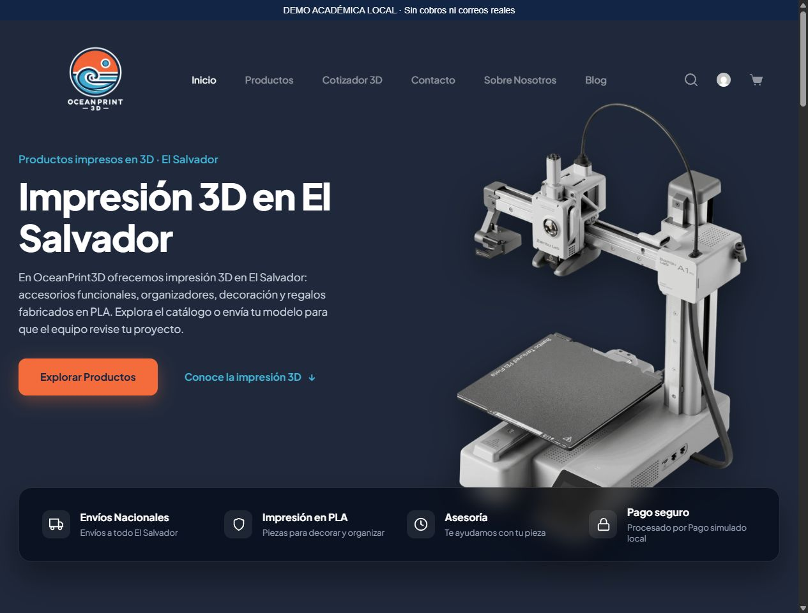
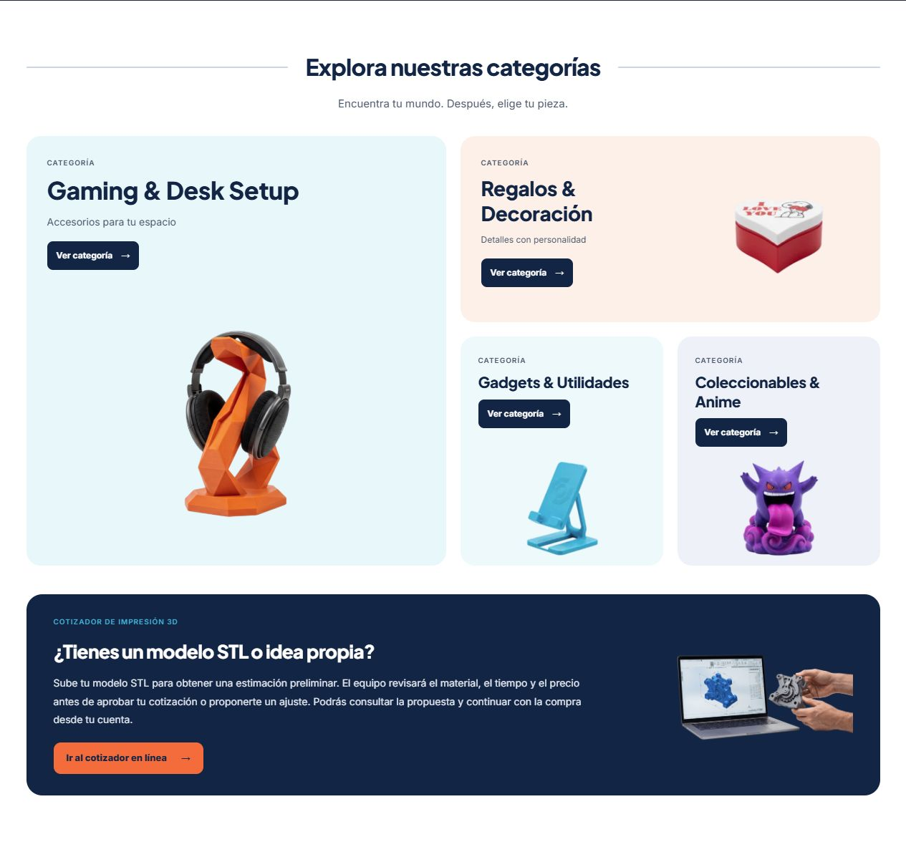
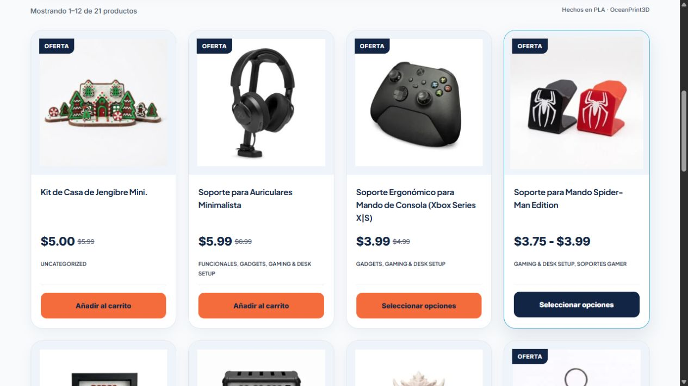
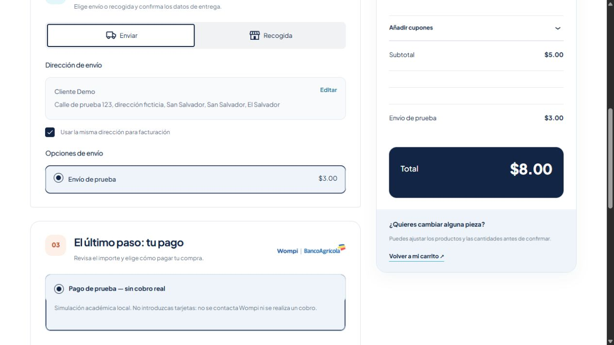
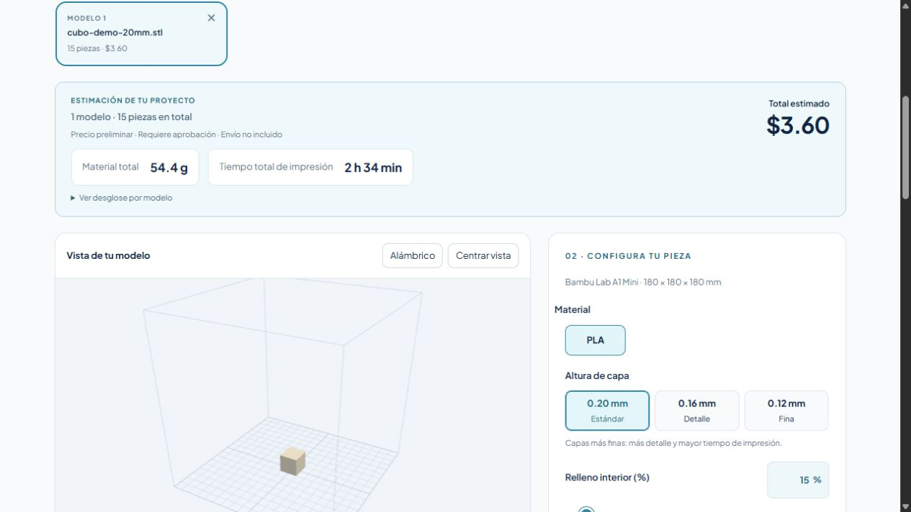
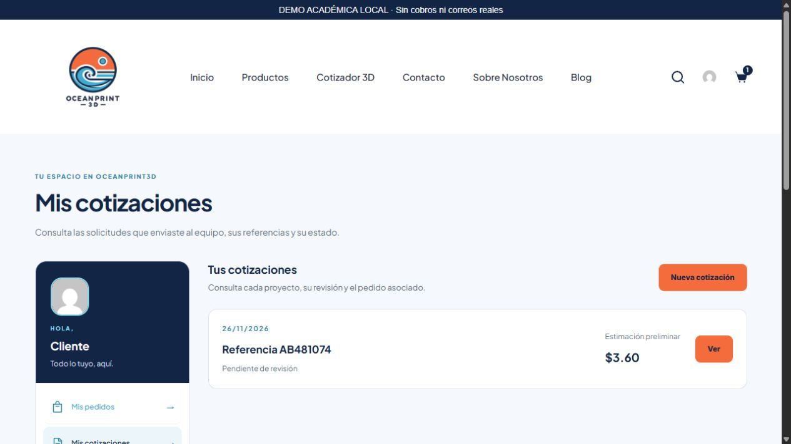
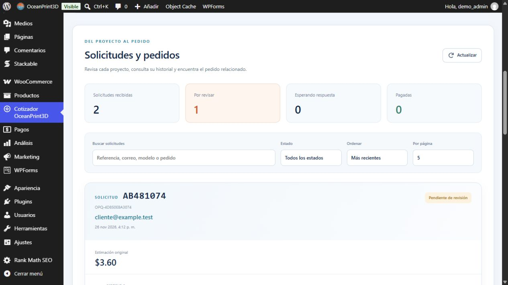

# Recorrido visual de OceanPrint3D

**14 capturas reales, renovadas el 26/11/2026**, tomadas de la demo final de Docker que corresponde a la implementación privada verificada. Conservan la identidad del sitio original y muestran clientes, solicitudes y pedidos ficticios. No son maquetas.

La arquitectura original en VPS sigue siendo la referencia del proyecto. Estas imágenes muestran la adaptación local, con pago simulado y correo interno. El logo de Wompi conserva la referencia visual del diseño; no significa que la demo haga cobros.

## Tienda y contenido

### 1. Inicio

La cabecera, el logo y la impresora presentan la identidad de OceanPrint3D. El aviso superior identifica el entorno académico.

### 2. Categorías

La portada organiza accesos a familias de productos y a las solicitudes personalizadas. Las imágenes y la paleta pertenecen a la presentación recuperada del proyecto.

Ver captura: Categorías

### 3. Catálogo

Búsqueda, categorías, ordenación, precios y filtros ayudan a explorar la tienda. Se conservan 21 productos visibles y sus variantes; el producto interno del cotizador permanece oculto. Marcas y personajes son material del prototipo académico, sin afiliación ni oferta comercial vigente.

Ver captura: Catálogo

### 4. Sobre nosotros

La presentación explica el propósito y el proceso propuesto. Su contenido forma parte del ejercicio académico; no acredita fabricación o entregas comerciales.

Ver captura: Sobre nosotros

### 5. Blog

Las guías organizan información sobre materiales, uso y elección de las piezas. La estructura editorial conecta ese contenido con el catálogo y la atención.

Ver captura: Blog

### 6. Contacto

La página reúne información y un formulario. En local se usan contactos de demostración y los mensajes se reciben en Mailpit. Se comprobó el envío de una consulta ficticia desde la interfaz.

Ver captura: Contacto

## Cuenta y compra

### 7. Cuenta y pedidos

El cliente ficticio consulta sus pedidos y accede a cotizaciones, direcciones y datos. Los pedidos #1322 y #1323 corresponden a pruebas con envío y recogida; ambos quedaron en Procesando. La compra requiere iniciar sesión.

Ver captura: Cuenta y pedidos

### 8. Carrito

La pantalla relaciona producto, cantidad, subtotal, entrega y total. La prueba mostrada tiene $5.00 en piezas, $3.00 de envío y $8.00 de total. También se probaron selección de variante, cambio de cantidad y retirada del artículo.

Ver captura: Carrito

### 9. Checkout

Contacto, entrega y pago se presentan junto al resumen del pedido. La demo ofrece envío o recogida y usa una pasarela de prueba sin tarjetas ni cobro. La distribución se adapta al ancho de pantalla.

Ver captura: Checkout

### 10. Pedido confirmado

El pedido #1322 llegó a Procesando después del checkout con envío. El encuadre del recibo muestra la pieza, el importe, el costo de envío y el acceso a su documento. Confirmar un pedido simulado no acredita fabricación ni venta real.

Ver captura: Pedido confirmado

## Cotización, administración y comunicación

### 11. Cotizador 3D

Se cargó desde el navegador un STL sintético de 20 × 20 × 20 mm. Con PLA, capa de 0.20 mm, relleno del 15% y 15 copias, la estimación fue **$3.60**, **54.4 g** y **2 h 34 min**. El visor permite explorar el modelo; el servicio especializado realiza el cálculo. Son valores de prueba y requieren revisión humana.

Ver captura: Cotizador 3D

### 12. Seguimiento del cliente

La solicitud enviada al equipo aparece en la cuenta con su referencia, estimación y estado. La captura muestra una solicitud pendiente de revisión: enviar el modelo no confirma fabricación ni pago.

Ver captura: Seguimiento del cliente

### 13. Administración de solicitudes

El panel reúne solicitudes, estados, estimaciones y filtros para el equipo. La captura corresponde a la misma solicitud del cliente. También se verificó la aprobación administrativa con su notificación por correo.

Ver captura: Administración de solicitudes

### 14. Notificaciones y documentos

Mailpit recibió la solicitud, aprobaciones, avisos de pedido y confirmaciones de cliente de las pruebas. Los correos de pedido incluyen factura PDF adjunta. En la VPS se utilizaban Fluent SMTP y Brevo; aquí el buzón permanece dentro de Docker, sin entrega a Internet.

Ver captura: Notificaciones y documentos

[Arquitectura original y local](ARQUITECTURA.md) · [Contexto y participación](CONTEXTO_Y_PARTICIPACION.md) · [Resultados y aprendizajes](RESULTADOS_Y_APRENDIZAJES.md) · [Validación y estado](EVIDENCIA_Y_ESTADO.md)
