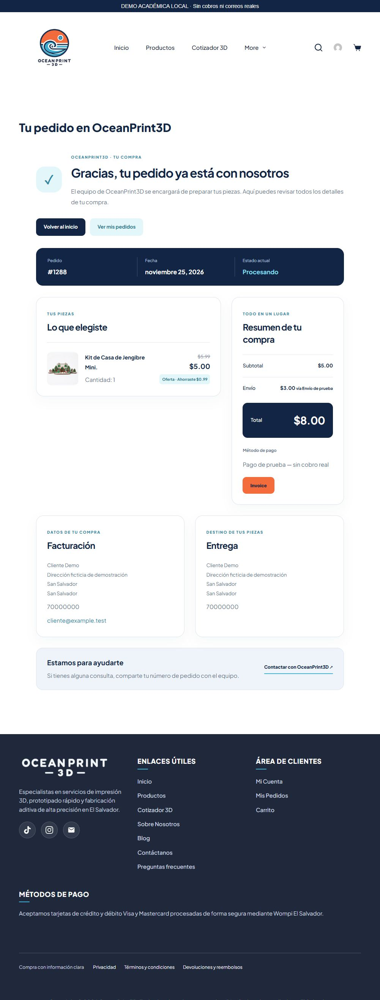
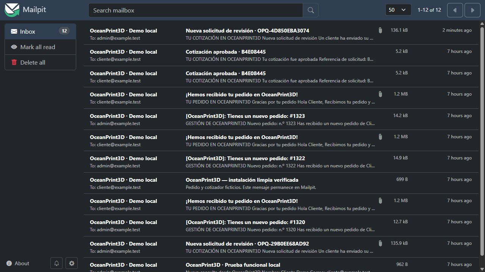

# Recorrido visual de OceanPrint3D

La galería presenta la experiencia del sitio construido para la VPS. **Las capturas se obtuvieron después en una copia local recuperada**: conservan su interfaz, pero no muestran una VPS actualmente activa. Al final aparece el correo de la adaptación local.

## 1. Inicio: presentar y orientar

La portada introduce la tienda y permite comenzar por catálogo o solicitud personalizada. La estructura, navegación y presentación forman parte del diseño del proyecto.

En el despliegue original, el cliente llegaba mediante Cloudflare y el proxy HTTPS de la VPS. [Ver la arquitectura](ARQUITECTURA.md#arquitectura-original-en-vps).

## 2. Catálogo: facilitar la elección

Imagen, categoría y precio ayudan a comprender la oferta. WordPress/WooCommerce conectan esa presentación con la administración.

Se conserva contenido académico de una versión del sitio. Marcas y personajes visibles no implican afiliación ni se ofrecen como recursos descargables. La instalación nueva genera un catálogo ficticio.

## 3. Cotizador: integrar una solicitud

El visor muestra el modelo y sus opciones. La web conecta con el servicio especializado para presentar una estimación y reunir información que revisará el equipo.

El modelo es un cubo sintético y el cálculo procede de la integración WordPress–cotizador. El importe es de demostración, no una tarifa publicada o venta. La visualización en el navegador y el análisis del backend son funciones diferentes.

## 4. Pedido: confirmar la operación digital

La confirmación reúne productos, importes, envío y acceso al documento. Permite explicar el vínculo entre checkout y pedido.

Ver el pedido simulado completo

El entorno original incluía Wompi; esta captura usa pago simulado y no representa un cobro de ese proveedor. Fabricación, calidad y entrega pertenecen al proceso operativo propuesto, no a lo demostrado por el recibo.

## 5. Adaptación local: notificaciones y PDF

En la VPS se trabajó con Fluent SMTP y Brevo. Para demostrar el recorrido en una PC, la entrega externa se sustituyó por Mailpit.

El buzón muestra solicitudes y pedidos con adjuntos. Los destinatarios son ficticios y el correo permanece en Docker; no muestra una bandeja Brevo ni entrega a Internet.

## Completar la lectura

Los [dos diagramas de arquitectura](ARQUITECTURA.md) separan VPS y local. El [contexto y la participación](CONTEXTO_Y_PARTICIPACION.md) distinguen asignaturas, rol previsto y trabajo realizado. Los [aprendizajes](RESULTADOS_Y_APRENDIZAJES.md) relacionan el entorno con mi experiencia.
