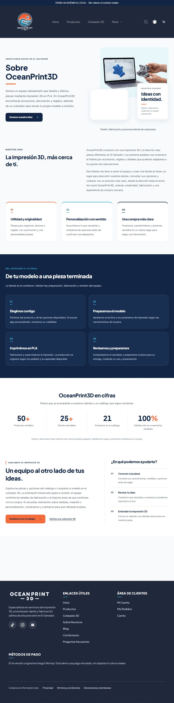
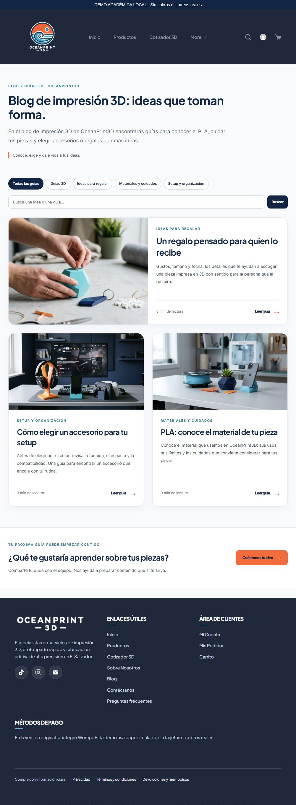
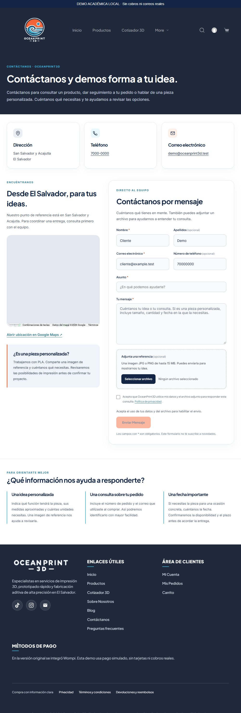
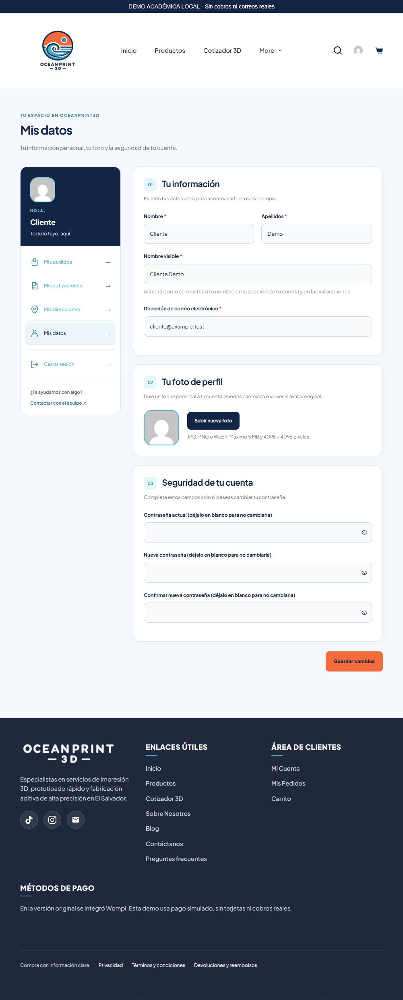
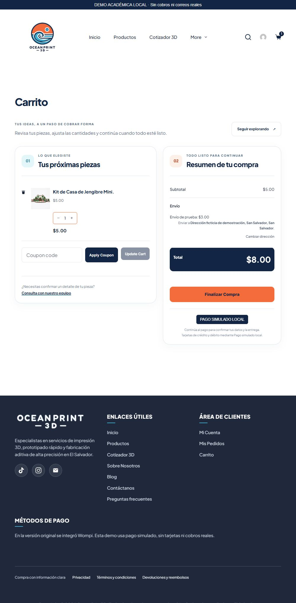

# Recorrido visual de OceanPrint3D

**Once capturas de la misma versión local que se distribuye en el repositorio privado**, tomadas el 25/11/2026. La demo conserva el diseño y el contenido visual del sitio original: logo, colores, menús, imágenes y páginas. Los clientes, solicitudes y pedidos utilizados en estas pruebas son ficticios.

La VPS sigue siendo la referencia arquitectónica del caso. Estas imágenes muestran su adaptación local, no un despliegue actualmente activo en Internet.

## Tienda y contenido

### 1. Inicio

La cabecera, el logo y la impresora del hero recuperan la identidad original. El aviso superior identifica la demostración académica.

### 2. Categorías y secciones del inicio

La portada continúa con categorías, productos, guías y comunidad. Las imágenes conservan el diseño del proyecto, en lugar de sustituirlo por figuras genéricas.

Ver el inicio completo, con categorías y sus imágenes

### 3. Catálogo

Presenta productos, imágenes, categorías, búsqueda, ordenación y filtros de precio. La copia conserva el catálogo académico y sus variantes; el producto técnico del cotizador permanece oculto.

Ver el catálogo y sus filtros

Los precios visibles son provisionales del prototipo. Marcas y personajes forman parte del material académico conservado y no implican afiliación ni una oferta comercial de este repositorio.

### 4. Sobre nosotros

La página reúne la presentación, el propósito y la explicación del proceso. Su contenido pertenece a la propuesta académica; no se utiliza como prueba de ventas o fabricación comercial realizada.

Ver Sobre nosotros

### 5. Blog

Las guías conservan sus imágenes, categorías y presentación editorial. Permiten mostrar cómo se organizó contenido de apoyo a la tienda.

Ver el blog y las guías recuperadas

### 6. Contacto

La página mantiene su diseño, tarjetas y formulario. Los contactos se sustituyeron por datos de demostración; las pruebas locales no envían correo a Internet.

## Cuenta y recorrido de compra

### 7. Perfil del cliente

Se inició sesión con una cuenta ficticia y se consultaron sus datos, avatar y navegación de cuenta. No se muestran usuarios del sitio histórico.

Ver el perfil de Cliente Demo

### 8. Carrito con un producto añadido

El producto se añadió desde el catálogo. La pantalla relaciona pieza, cantidad, subtotal, envío de prueba y total antes de continuar.

Ver el carrito de la prueba

### 9. Cotizador 3D

Se cargó un STL desde el navegador. El visor y las opciones de impresión calcularon una estimación para **15 copias: $3.60**, **54.4 g** y **2 h 34 min** con los parámetros de prueba. Se comprobó el envío de la solicitud al equipo.

Ver el modelo, la estimación y los controles del cotizador

La estimación es preliminar y requiere revisión. El modelo es un cubo sintético; su importe no es una tarifa comercial.

### 10. Pedido confirmado

Se completó el checkout de bloques con el cliente ficticio y la pasarela local. El pedido **#1288** llegó a **Procesando**, sin tarjeta ni cobro real.

Ver la confirmación completa del pedido simulado

La operación física de fabricación, control de calidad y entrega es parte del proceso propuesto, no algo acreditado por el recibo.

## Comunicación y documentos

### 11. Notificaciones y PDF en Mailpit

La misma demo generó la solicitud, el aviso de pedido y la confirmación del cliente con factura adjunta. El buzón conserva también mensajes ficticios de pruebas anteriores.

En la VPS se trabajó con Fluent SMTP/Brevo. Aquí Mailpit recibe los mensajes dentro de Docker; no representa un panel de Brevo ni entrega externa.

[Arquitectura original y local](ARQUITECTURA.md) · [Contexto y participación](CONTEXTO_Y_PARTICIPACION.md) · [Aprendizajes](RESULTADOS_Y_APRENDIZAJES.md)
